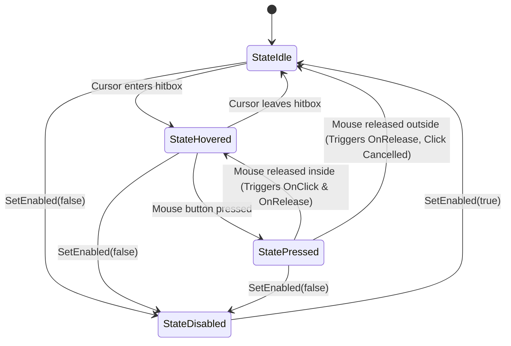

# interaksi

`interaksi` is a lightweight, high-performance 2D spatial interaction and hit-testing component library for [Ebitengine](https://ebitengine.org).

Designed specifically for in-game HUDs, inventory grids, clickable props, and lightweight UI where spinning up full heavy UI frameworks is overkill.

---

## Key Features

- **Spatial Math & AABB Engine**: Fast Axis-Aligned Bounding Box calculation with point containment, box-box intersections, and center math.
- **Auto-Synced Hitboxes**: Automatically derives world hitboxes from image dimensions, `(X, Y)` position, `(Sx, Sy)` scaling, and `(Ox, Oy)` origins/pivots.
- **Manual Padding & Inset Tuning**: Expand hitboxes for small mobile/touch targets (`WithHitboxPadding`) or shrink hitboxes to ignore transparent borders (`WithHitboxInset`).
- **Interaction Lifecycle Events**: Full state tracking (`StateIdle`, `StateHovered`, `StatePressed`, `StateDisabled`) with callbacks:
  - `OnClick(func(btn ebiten.MouseButton))`
  - `OnHoverEnter(func())` / `OnHoverExit(func())`
  - `OnPress(func())` / `OnRelease(func())`
  - `OnDrag(func(dx, dy float64))`
- **Z-Index Layer Dispatcher**:
  - **Drawing**: Render registered elements sorted ascending by layer priority.
  - **Hit-Testing**: Top-to-bottom event propagation; higher Z-index components absorb clicks and hover states.
- **Pointer Capture & Dragging**: Holding down the mouse captures pointer events so dragging outside the item maintains press/drag without spurious hovers. Releasing outside cancels the click cleanly.
- **Decoupled Input Coordinates**: Accepts explicit cursor/pointer coordinates as parameters—ideal for virtual viewports, camera translations, touch input, and headless unit testing.
- **Functional Options Pattern**: Idiomatic Go API: `interaksi.New(img, interaksi.WithPosition(x, y), ...)`.
- **Debug Outlines**: Built-in debug rendering of hitboxes color-coded by interaction state.

---

## Interaction Lifecycle Flow



---

## Installation

```bash
go get github.com/senjalab/interaksi
```

---

## Quickstart

```go
package main

import (
	"image/color"
	"log"

	"github.com/hajimehoshi/ebiten/v2"
	"github.com/hajimehoshi/ebiten/v2/vector"
	"github.com/senjalab/interaksi"
)

type Game struct {
	manager *interaksi.Manager
}

func (g *Game) Update() error {
	// 1. Read input coordinates (can be world, screen, or touch)
	cx, cy := ebiten.CursorPosition()
	isMouseDown := ebiten.IsMouseButtonPressed(ebiten.MouseButtonLeft)

	// 2. Feed decoupled input into Manager (handles top-to-bottom propagation)
	g.manager.Update(cx, cy, isMouseDown)
	return nil
}

func (g *Game) Draw(screen *ebiten.Image) {
	screen.Fill(color.RGBA{R: 20, G: 24, B: 34, A: 255})
	// 3. Render items sorted by Z-index
	g.manager.Draw(screen)
}

func (g *Game) Layout(w, h int) (int, int) {
	return 640, 480
}

func main() {
	ebiten.SetWindowSize(640, 480)
	ebiten.SetWindowTitle("Quickstart Demo")

	mgr := interaksi.NewManager()

	// Create sample button sprite
	btnImg := ebiten.NewImage(140, 44)
	vector.FillRect(btnImg, 0, 0, 140, 44, color.RGBA{R: 40, G: 80, B: 150, A: 255}, false)

	hoverTint := ebiten.ColorScale{}
	hoverTint.Scale(1.3, 1.3, 1.1, 1.0)

	// Register interactable with functional options
	btn := interaksi.New(btnImg,
		interaksi.WithName("StartGameBtn"),
		interaksi.WithPosition(250, 200),
		interaksi.WithZIndex(10),
		interaksi.WithStateTint(interaksi.StateHovered, hoverTint),
		interaksi.WithOnClick(func(btn ebiten.MouseButton) {
			println("Start Game Clicked!")
		}),
	)
	mgr.Register(btn)

	if err := ebiten.RunGame(&Game{manager: mgr}); err != nil {
		log.Fatal(err)
	}
}
```

---

## Running the Full Interactive Demo

A complete demo demonstrating **hover tinting**, **drag/click detection**, **overlapping Z-index priority**, **disabled states**, and **debug hitboxes** is included:

```bash
# Run directly from root:
go run main.go

# Or run via examples:
go run ./examples/demo

# Or run via cmd:
go run ./cmd/demo
```

### Demo Features & Hotkeys

- **Cast Spell Button**: Demonstrates state tinting (warm highlight on hover, shadow on press).
- **Toggle Target & Locked Button**: Demonstrates disabling buttons and grayed-out state tinting.
- **Overlapping Cards**: Shows Ruby Dragon (Z=10) and Sapphire Golem (Z=20). Hovering and clicking in the overlap region strictly prioritizes the higher Z-index.
- **Draggable Relic**: Click and drag to move the Golden Relic around the screen smoothly.
- **Padded Hitbox**: Small 28x28 crystal ring with `+22px` uniform hitbox padding.
- **Live Event Log**: On-screen feed logging pointer events, clicks, drags, and layer changes.
- **Hotkeys**:
  - `[D]`: Toggle AABB debug outlines (Green = Idle, Yellow = Hovered, Red = Pressed, Gray = Disabled).
  - `[Z]`: Dynamically swap Z-index layers of the overlapping cards (`mgr.BringToFront`).
  - `[R]`: Reset Draggable Relic position.

---

## API Reference

### 1. Spatial Math (`AABB`, `Vec2`, `Insets`)

```go
type AABB struct {
    Min Vec2
    Max Vec2
}

func NewAABB(minX, minY, maxX, maxY float64) AABB
func (a AABB) Contains(px, py float64) bool
func (a AABB) Intersects(other AABB) bool
func (a AABB) Width() float64
func (a AABB) Height() float64
func (a AABB) Center() Vec2
func (a AABB) Pad(pad Insets) AABB
func (a AABB) Inset(inset Insets) AABB
```

### 2. Core Component (`Interactable`)

Construct with `interaksi.New(img *ebiten.Image, opts ...Option)`:

| Method | Description |
|---|---|
| `SetPosition(x, y float64)` | Updates world coordinates |
| `Move(dx, dy float64)` | Translates position by delta |
| `SetScale(sx, sy float64)` | Sets horizontal and vertical scale |
| `SetOrigin(ox, oy float64)` | Sets local pixel origin/pivot |
| `SetPivot(nx, ny float64)` | Sets normalized origin (`0.5, 0.5` = center) |
| `SetZIndex(z int)` | Sets layer priority and triggers manager re-sort |
| `Hitbox() AABB` | Computes active AABB synced with image, scale, origin, and insets |
| `SetHitboxPadding(top, right, bottom, left float64)` | Expands clickable area beyond sprite bounds |
| `SetHitboxInset(top, right, bottom, left float64)` | Shrinks clickable area within sprite bounds |
| `SetCustomHitbox(box *AABB)` | Overrides auto-computed hitbox with custom AABB |
| `SetEnabled(enabled bool)` | Enables or disables interaction |
| `SetVisible(visible bool)` | Sets visibility (hidden items are not drawn or hit-tested) |
| `SetBlocksInput(blocks bool)` | Whether this item consumes hit-tests (default `true`) |
| `OnClick(func(btn ebiten.MouseButton))` | Click callback |
| `OnHoverEnter(func())` / `OnHoverExit(func())` | Hover lifecycle callbacks |
| `OnPress(func())` / `OnRelease(func())` | Mouse press and release callbacks |
| `OnDrag(func(dx, dy float64))` | Invoked when moved while pressed |
| `SetStateColorScale(state State, cs ebiten.ColorScale)` | Assigns state tint |

### 3. Manager (`Manager`)

Construct with `interaksi.NewManager()`:

| Method | Description |
|---|---|
| `Register(item *Interactable)` | Registers an interactable |
| `Unregister(item *Interactable)` | Unregisters an interactable and cleans up active states |
| `Clear()` | Removes all registered interactables |
| `Update(cursorX, cursorY int, isMouseDown bool)` | Propagates input top-to-bottom with event consumption |
| `Draw(screen *ebiten.Image)` | Draws registered items sorted by Z-index (ascending) |
| `HitTest(px, py float64) *Interactable` | Returns top-most interactable at coordinate |
| `HoveredItem() *Interactable` | Returns currently hovered interactable |
| `PressedItem() *Interactable` | Returns currently pressed/dragged interactable |
| `BringToFront(item *Interactable)` | Sets item to highest Z-index |
| `SendToBack(item *Interactable)` | Sets item to lowest Z-index |
| `SetDebugDraw(enabled bool)` | Toggles state-colored AABB hitbox outlines |

---

## Testing

Comprehensive unit tests are provided covering spatial containment, scale/origin hitbox transformations, state machine transitions, click cancellations, Z-index event consumption, dragging deltas, and edge cases:

```bash
go test -v ./...
```

Coverage report:
```bash
go test -cover ./...
```

---

## License

MIT License. Designed and crafted for high-performance 2D game development.
